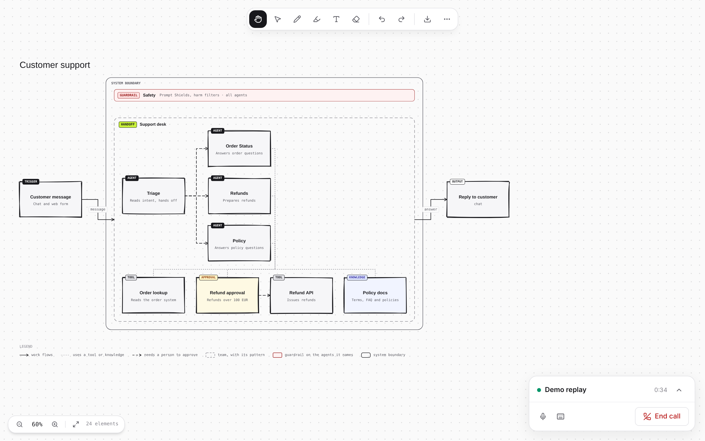

# Teolima

A voice-first studio for designing multi-agent systems for Microsoft Agent Framework and Azure AI Foundry. You give a short brief and talk the design through with a coach on the Gemini Live API. The coach builds it on a hand-drawn board as you speak: triggers, teams of agents in an orchestration pattern, tools, knowledge, guardrails and human approvals.



**Where it is going:** one unified git tree as the source of truth, many actors committing to it, two views of the same tree, and one compile target.

> You speak a multi-agent system into being. The coach, the memory workers and you all commit to one git tree, colour-coded by actor. Flip between the whiteboard and the code view of the same tree. Click Compile and it becomes a reviewed Azure AI Foundry deployment package: Bicep for the infrastructure, agent definitions for the agents.

The voice coach, the whiteboard and the hardening below are built. The unified tree, the memory workers and the compiler are designed in [docs/ROADMAP.md](docs/ROADMAP.md) with one decision record each.

## Try it

Requires Node 20 or later.

```bash
npm install
cp .env.example .env     # optional: add GEMINI_API_KEY for live coaching
npm run dev              # http://localhost:3000
```

Without a key, press **Start call** and the app replays a recorded design session through the same tool-call path a live session uses. With a key, allow the microphone and describe what you want to build, or pick a topic from **Ideas**.

## How it works

```
Browser                          Server (Express + ws)                  Gemini Live API
mic PCM 16 kHz  ── /ws/live ───▶ origin + token check   ── audio ────▶  speech in, speech out
                                 board session + change log ◀─ tools ─  add_component, set_team, connect, ...
canvas engine   ◀── board ────── validated board model
speaker 24 kHz  ◀── audio ────── session + idle caps     ◀── audio ────
```

1. The browser streams microphone audio to the server over a websocket. The API key never leaves the server.
2. Nothing is built before there is a brief: a goal, who uses the system, and its constraints. You can write it before the call, or the coach asks for it and confirms it back. The server refuses every building change until the goal is saved.
3. The coach builds the design with tools that edit a typed board model (agents, tools, knowledge, teams with an orchestration pattern, guardrails, approvals, triggers, outputs, connections). It never draws shapes or chooses positions.
4. Every edit is a change with an actor and a reason, validated by the change log: names map to stable ids, so nothing is created twice, and references are checked by kind. A refused change tells the model why.
5. After each accepted change the server sends the board to the browser. The layout is computed from the board (`shared/board/layout.ts`): teams laid out by pattern, resources in a lane below, connectors routed around cards.
6. Before advising on anything specific to Agent Framework, Foundry, guardrails, evaluations or Azure resources, the coach searches Microsoft Learn through Microsoft's official documentation server and bases its advice on the excerpts.
7. Tools are non-blocking on Live models that support it, so the coach keeps talking while the board updates.

The board model and what each element compiles to: [docs/BOARD_MODEL.md](docs/BOARD_MODEL.md). Details: [docs/ARCHITECTURE.md](docs/ARCHITECTURE.md).

## Security

| Concern | Control |
|---|---|
| Key exposure | Key stays server-side; the browser talks only to this server |
| Unwanted clients | Origin allowlist on the websocket; optional `ACCESS_TOKEN` for hosted demos |
| Runaway cost | Connection cap, hard session limit, idle timeout |
| Malformed or hostile tool calls | Server-side validation of every tool call and argument |
| Invented or ungrounded designs | No building before a brief with a goal (enforced by the change log); every element must trace to the brief or the user; no web search, image generation or free drawing |
| Prompt injection | The brief and documentation results are passed as the user's words or reference material, never as instructions; the prompt's rules cannot be changed in conversation |
| Oversized input | 200 KB JSON limit, 4 MB websocket frames, goal and file context truncated |

All limits are configurable in `.env` (see `.env.example`).

## Project layout

```
server.ts              Express app, websocket bridge, Live API session
server/config.ts       Environment configuration and limits
server/security.ts     Origin and token checks, rate limiter
server/validation.ts   Tool-call validation
server/demo.ts         Recorded session for demo mode
server/board-tools.ts  The coach's board tools and per-session board
server/prompts/        Versioned coach prompt
shared/board/          Typed board model, change log and layout (docs/BOARD_MODEL.md)
src/lib/canvas/        Canvas engine and hand-drawn renderer
src/lib/audio/         Microphone capture and playback
src/components/        Whiteboard, toolbar, call HUD, goal setup, history
tests/                 node:test suites
docs/                  Architecture, roadmap, decision records, verified Azure targets
```

## Scripts

| Command | What it does |
|---|---|
| `npm run dev` | Server with hot reload on port 3000 |
| `npm test` | Unit tests (board model, layout, tools, validation, demo) |
| `npm run lint` | TypeScript typecheck |
| `npm run build` | Production build of client and server into `dist/` |
| `npm start` | Run the production build |
| `npm run check:docs` | Run one real Microsoft Learn search from this machine |

CI runs typecheck, tests and build on every push and pull request.

## Configuration

| Variable | Default | Purpose |
|---|---|---|
| `GEMINI_API_KEY` | none | Live coaching. Without it, demo mode |
| `GEMINI_LIVE_MODEL` | `gemini-3.8-live` | Speech-to-speech model, with asynchronous tool calls |
| `GEMINI_LIVE_FALLBACK_MODEL` | `gemini-3.1-flash-live-preview` | Used if the primary model cannot be reached |
| `MICROSOFT_DOCS_MCP_URL` | Microsoft Learn MCP server | Documentation grounding for the coach; `off` disables it |
| `ALLOWED_ORIGINS` | `http://localhost:PORT` | Browser origins allowed on the websocket |
| `ACCESS_TOKEN` | none | Required token for hosted demos (`?token=...`) |
| `MAX_CONNECTIONS`, `SESSION_MAX_MINUTES`, `IDLE_TIMEOUT_SECONDS` | 20, 15, 120 | Cost and abuse limits |
| `VITE_SUPABASE_URL`, `VITE_SUPABASE_ANON_KEY` | none | Saved sessions in Supabase; otherwise kept in the browser |

## License

All rights reserved.
