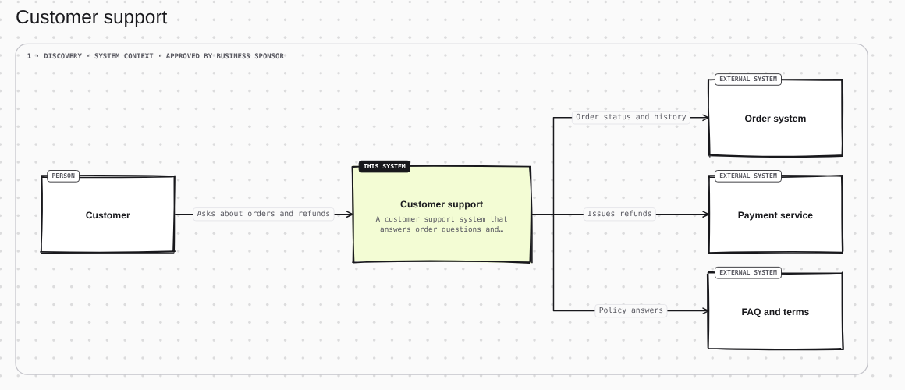
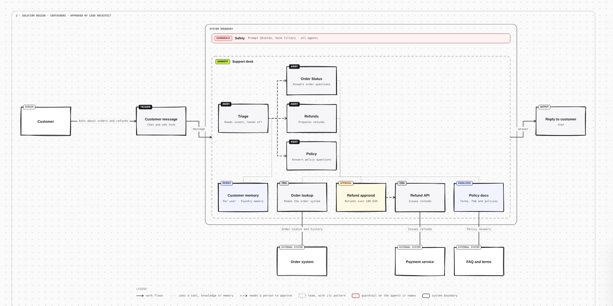
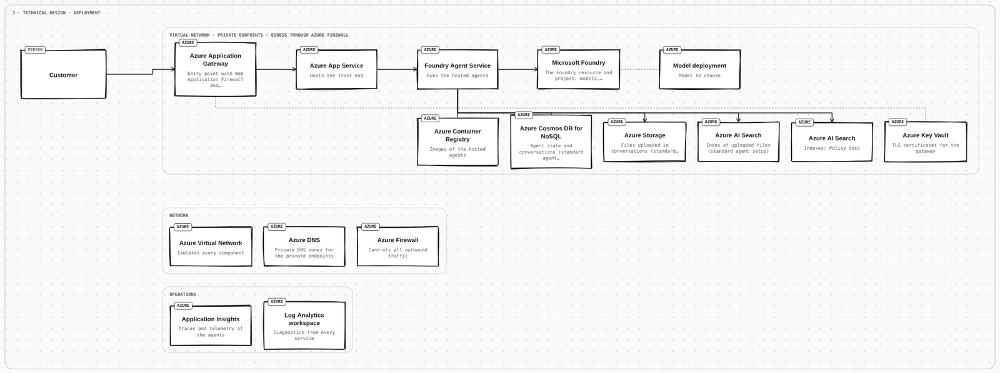
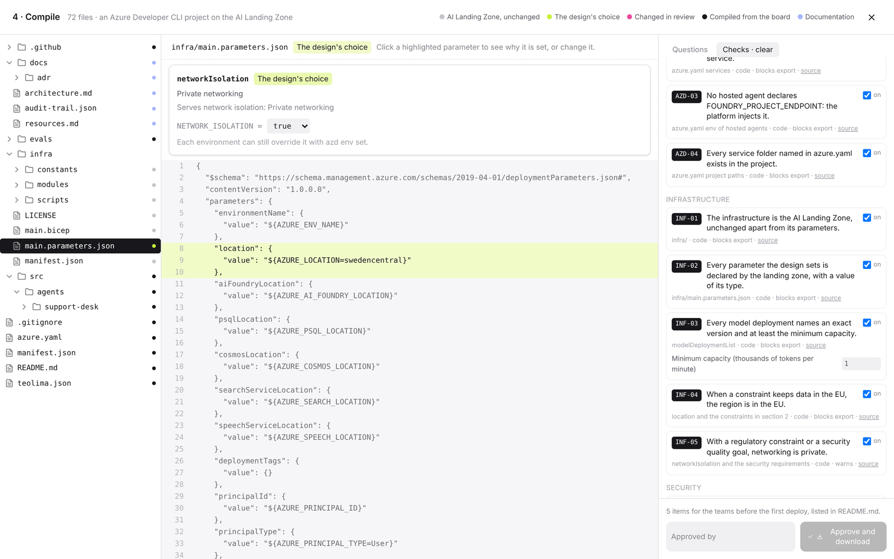

# Teolima

Teolima turns a client scoping conversation into an approved Microsoft Foundry design and a complete Azure Developer CLI project for infrastructure and agent teams to review, check and deploy.

## The problem

At a Microsoft partner, an AI agent solution goes through weeks of workshops with business and IT stakeholders before anyone writes infrastructure code. What comes out is spread over meeting notes, slides, diagrams and spreadsheets, each rebuilt by hand. Nothing records which requirement led to which decision, so the reasons get lost between pre-sales and delivery, and the engineers who deploy find the gaps late. Generic AI tools make the writing faster but not more reliable: one model drafts everything, and nothing checks it against Microsoft's own guidance.

## The approach

A voice coach (Gemini Live) works through Microsoft's architect process with the architect, in four stages. Each stage is for different people, has its own documents (arc42) and diagram (C4), and moves on only when a person approves it. The coach can propose; it cannot approve.

| Stage | For | Produces |
|---|---|---|
| 1. Discovery | Business sponsor | Functional specification (arc42 1 to 3), C4 system context |
| 2. Solution design | Architect, client tech lead | Strategy, building blocks, runtime scenarios, decision records (arc42 4, 5, 6, 9), C4 container and dynamic views |
| 3. Technical design | Security and platform leads | Deployment settings, crosscutting concepts, quality scenarios, risks (arc42 7, 8, 10, 11), the Well-Architected review, C4 deployment view |
| 4. Compile | Infrastructure and agent teams | An azd project on the AI Landing Zone, checked by narrow rules before export |

Every item in the documents records its source (the client's words, the brief or a pasted transcript), and the server refuses a quote that was never said. Each stage gate lists any design element that does not trace back to a requirement.

| Discovery | Solution design |
|---|---|
|  |  |
| **Technical design** | **Compile** |
|  |  |

## Run it

Requires Node 20 or later and a browser with a microphone (Chrome or Edge).

```bash
git clone https://github.com/thuyghe12/teolima_public.git
cd teolima_public
npm install
cp .env.example .env
```

Open `.env` and put your Gemini API key (from [Google AI Studio](https://aistudio.google.com/apikey)) after `GEMINI_API_KEY=`, without spaces or quotes. Then start the app and open http://localhost:3000:

```bash
npm run dev
```

**A live session**

1. Write the brief in the call panel: the goal, who uses it and any constraint (for example *Answer order questions and handle refunds safely*, *Customers of a web shop*, *Refunds over 100 EUR need a person*). You can also skip this and tell the coach.
2. Press **Start call** and allow the microphone. Talk the case through as you would with a client. The coach asks one question at a time, records each answer in the stage document with your words as its source, and draws the diagram as you go. To type instead of speaking, use the keyboard icon; to add a meeting transcript or notes, use the paste icon.
3. When the stage bar shows nothing left to go, review the document (**Document**) and press **Approve**. Only you can approve; the coach then moves to the next stage. Discovery, solution design and technical design each end this way.
4. After technical design, press **Open the project**, answer the few questions no stage settled (such as each model's version and capacity, for example `gpt-4.1`, `2025-04-14`, `50`) and press **Compile**.
5. Review the project. `infra/main.parameters.json` shows the design's choices in green; click one to see why it is set, or change it and watch the checks react. **Approve and download** exports the project with `docs/checks.md`.

**Without a key**, **Start call** replays a recorded session through the same path a live session uses, in about a minute and a half, and you continue from step 4.

From the command line: `npm test` runs the 192 tests, and `npm run compile:example` compiles the demo design to `out/customer-support`.

## Design decisions

Each with what was chosen and what was rejected. The full records are in [docs/adr](docs/adr).

1. **Build on Microsoft's AI Landing Zone, unchanged; set only its parameters.** Rejected: generating Bicep from scratch. Generated infrastructure cannot be trusted by a platform team and drifts from Microsoft's baseline; the landing zone is what they already review. The design's choices land as defaults in its own parameters file, still overridable per environment. ([ADR 0003](docs/adr/0003-compile-to-foundry-package.md))
2. **A versioned snapshot of Microsoft's guidance, read by progressive disclosure, every cited link tested.** Rejected: embedding the docs in a vector store. Retrieval would be nondeterministic and citations unverifiable, and running the repo would need a database. The snapshot refreshes weekly through a reviewed pull request. ([ADR 0006](docs/adr/0006-guidance-snapshot.md))
3. **The model proposes; a typed change log disposes.** Rejected: letting the model draw shapes or write free text into the design. Every change is validated, refused with a reason the model can act on, and recorded with its actor and its quoted source, checked against what was actually said. ([ADR 0001](docs/adr/0001-board-as-versioned-tree.md), [ADR 0005](docs/adr/0005-high-level-board-exact-meaning.md))
4. **Stages per audience, documented as arc42 and drawn as C4, approved only by a person.** Rejected: one generated design for everyone. Discovery, solution design and technical design are different work for different people; a gate the coach cannot pass keeps a person accountable at each step. ([ADR 0007](docs/adr/0007-scope-to-iac.md), [ADR 0008](docs/adr/0008-arc42-and-c4.md))
5. **Narrow deterministic rules check the output; model judges and people are the escalation.** Rejected: one model reviewing its own work. 21 rules each own one signal (a schema, code or a regular expression) with a threshold and a source; the user sees the matrix, tunes it and adds rules, and a blocking failure stops the export.

The test that keeps this honest: a Microsoft reference architecture (multiple-agent workflow automation), specified from its published page, must come out of the stages with Microsoft's own decisions. Its first run found a rule stricter than Microsoft's guidance.

## Status

Built: the four stages, the guidance snapshot, the compiler, the checks, the folder view and the export. The compiled `azure.yaml` validates against the azd and Foundry extension schemas, and every landing zone parameter it sets against the landing zone's declarations; CI builds the compiled Bicep. Not yet: a deployment to a live subscription, versioning each project in its own git tree, pushing the project to GitHub, model judges for the checks code cannot make, Microsoft's official Azure icons on the deployment view, and the cost estimate and statement of work. The order is in [docs/ROADMAP.md](docs/ROADMAP.md).

## How it works

```
Browser                          Server (Express + ws)                  Gemini Live API
mic PCM 16 kHz  ── /ws/live ───▶ origin + token check   ── audio ────▶  speech in, speech out
                                 board session + change log ◀─ tools ─  add_component, set_team, connect, ...
canvas engine   ◀── board ────── validated board model
speaker 24 kHz  ◀── audio ────── session + idle caps     ◀── audio ────
```

1. The browser streams microphone audio to the server over a websocket. The API key never leaves the server.
2. The session moves through four stages, each for different people with its own diagram: discovery (business sponsor: context diagram and functional specification), solution design (architect: container and dynamic views, solution design document), technical design (security and platform leads: deployment view, technical design document, Well-Architected review) and compile. Each stage draws below the last on the same board. Only you can approve a stage, in the stage bar; the coach can only ask, and the server refuses changes outside the current stage.
3. Discovery comes first, the way Microsoft's architect guidance describes it: listen, probe for the motivation, clarify into measurable requirements, evaluate constraints and trade-offs. The result is the functional specification, structured as arc42 sections 1 to 3: goals, success metrics, user flows, what needs a person, quality goals, stakeholders, constraints, scope, and the business context that draws the C4 system context diagram. Each item quotes its source: your words in the call, the brief, or a transcript, RFP or notes you paste. The document opens from the stage bar and is yours to edit: add, change and remove items inline, and add sections of your own. It exports as Markdown.
4. Solution design is Microsoft's recommend step, structured as arc42 sections 4, 5, 6 and 9: the solution strategy, the building blocks, a numbered runtime scenario for every user flow, and decision records for platform, level of complexity, orchestration pattern and agent hosting, each with the options weighed and their consequences. Every building block names the requirements it serves; the solution design cannot be approved while a user flow, an oversight rule or an external system is not covered. It draws as a C4 container view, with the context diagram's people and systems around the system boundary, and a dynamic view per scenario. The acceptance test is a Microsoft reference architecture, multiple-agent workflow automation, specified from its published page: the stages must reproduce Microsoft's decisions.
5. Technical design settles what the compiler needs, as arc42 sections 7, 8, 10 and 11: the settings that are hard to change after deployment (region, network isolation, platform landing zone), the crosscutting concepts, a measurable quality scenario for every quality goal, and an assumption for every discovery topic left open. The Well-Architected review records every recommendation of the five pillar checklists as met, partly met, not met or not applicable; what is not met becomes a risk. The deployment view draws the Azure resources the baseline Foundry architecture prescribes for this design, each with its source: the same list the compiler generates Bicep for.
6. The coach follows a written design standard anchored in Microsoft's guidance ([docs/DESIGN_STANDARD.md](docs/DESIGN_STANDARD.md)): discovery, one agent or several, orchestration pattern, tools and knowledge, guardrails, human approvals, where work enters and leaves. One agent with tools is the default; the server refuses a second agent until a reason from the guidance is recorded.
7. The coach builds the design with tools that edit a typed board model (agents with their model, tools, knowledge, memory and conversation history; teams with an orchestration pattern; guardrails, approvals, triggers, outputs, connections), each with one exact compile meaning in Agent Framework, Foundry or Azure ([docs/BOARD_MODEL.md](docs/BOARD_MODEL.md)). It never draws shapes or chooses positions.
8. Every edit is a change with an actor and a reason, validated by the change log: names map to stable ids, so nothing is created twice, and references are checked by kind. A refused change tells the model why.
9. After each accepted change the server sends the board to the browser. The layout is computed from the board (`shared/board/layout.ts`): teams laid out by pattern, resources in a lane below, connectors routed around cards.
10. Before advising on anything specific to Agent Framework, Foundry, guardrails, evaluations or Azure resources, the coach searches Microsoft Learn through Microsoft's official documentation server and bases its advice on the excerpts.
11. Tools are non-blocking on Live models that support it, so the coach keeps talking while the board updates.

The board model and what each element compiles to: [docs/BOARD_MODEL.md](docs/BOARD_MODEL.md). Details: [docs/ARCHITECTURE.md](docs/ARCHITECTURE.md).

## Security

| Concern | Control |
|---|---|
| Key exposure | Key stays server-side; the browser talks only to this server |
| Unwanted clients | Origin allowlist on the websocket; optional `ACCESS_TOKEN` for hosted demos |
| Runaway cost | Connection cap, hard session limit, idle timeout |
| Malformed or hostile tool calls | Server-side validation of every tool call and argument |
| Invented or ungrounded designs | No building before a brief with a goal (change log); every building change must quote its basis, and the server checks the quote against the brief and the user's transcribed words (provenance); no web search, image generation or free drawing |
| Prompt injection | Prompt Shields screens the brief, typed messages, finished speech turns and documentation results; documentation keeps only Microsoft Learn links and is withheld if it cannot be screened; the brief and documents are passed as data, never as instructions |
| Instruction leaks | The coach's transcribed speech is checked for reciting its instructions |
| Accountability | Per-session audit trail of every guard decision and every accepted or refused change with its basis (`logs/audit`) |
| Oversized input | 200 KB JSON limit, 4 MB websocket frames, capped brief and typed messages |

The guard pipeline and its limits are described in [docs/ARCHITECTURE.md](docs/ARCHITECTURE.md#guard-pipeline). Speech reaches the model as audio, so a spoken turn is screened after the model has heard it: a flagged turn gets a notice to the model and to the user, and nothing it asks for can reach the board without passing provenance and the change log.

All limits are configurable in `.env` (see `.env.example`).

## Project layout

```
server.ts              Express app, websocket bridge, Live API session
server/config.ts       Environment configuration and limits
server/security.ts     Origin and token checks
server/validation.ts   Tool-call validation
server/guard/          Guard pipeline: provenance, Prompt Shields, audit trail
server/demo.ts         Recorded session for demo mode
server/board-tools.ts  The coach's board tools and per-session board
server/prompts/        Versioned coach prompt
server/knowledge.ts    Loads the guidance snapshot at startup
server/compile/        The compiler, the rule checks and the export (ADR 0003)
shared/board/          Typed board model, change log, stages, documents and layout (docs/BOARD_MODEL.md)
shared/compile/        The compile questions and the rubric, shared with the app
shared/knowledge/      Guidance snapshot: sources, parser, and the outline/page/section/find library
scripts/knowledge/     Builds the snapshot from Microsoft Learn and checks it
data/knowledge/        The snapshot: Microsoft's architecture guidance as pages and sections (CC BY 4.0)
vendor/                The AI Landing Zone Bicep and the azd schemas, pinned (vendor/README.md)
src/lib/canvas/        Canvas engine and hand-drawn renderer
src/lib/audio/         Microphone capture and playback
src/components/        Whiteboard, stage bar, stage documents, compile studio, call panel
tests/                 node:test suites
docs/                  Architecture, design standard, roadmap, decision records, verified Azure targets
```

## Scripts

| Command | What it does |
|---|---|
| `npm run dev` | Server with hot reload on port 3000 |
| `npm test` | The tests: board model, stages, documents, layout, tools, guard, compiler, checks, and the Microsoft reference architecture |
| `npm run compile:example` | Compile the demo design to `out/customer-support` |
| `npm run lint` | TypeScript typecheck |
| `npm run build` | Production build of client and server into `dist/` |
| `npm start` | Run the production build |
| `npm run check:docs` | Run one real Microsoft Learn search from this machine |
| `npm run knowledge:build` | Rebuild the guidance snapshot in `data/knowledge/` from Microsoft Learn |
| `npm run knowledge:verify` | Check the snapshot (page counts, sections, links, checklist items per pillar) |
| `npm run knowledge:checklists` | Regenerate the Well-Architected checklists the app ships from the snapshot |

CI runs typecheck, tests and build on every push and pull request, and builds and lints the Bicep of the compiled demo design. A weekly workflow rebuilds the guidance snapshot and proposes any change as a pull request.

## Configuration

| Variable | Default | Purpose |
|---|---|---|
| `GEMINI_API_KEY` | none | Live coaching. Without it, demo mode |
| `GEMINI_LIVE_MODEL` | `gemini-3.8-live` | Speech-to-speech model, with asynchronous tool calls |
| `GEMINI_LIVE_FALLBACK_MODEL` | `gemini-3.1-flash-live-preview` | Used if the primary model cannot be reached |
| `MICROSOFT_DOCS_MCP_URL` | Microsoft Learn MCP server | Documentation grounding for the coach; `off` disables it |
| `PORT` | `3000` | Port of the app and the API |
| `ALLOWED_ORIGINS` | `http://localhost:PORT` | Browser origins allowed on the websocket |
| `ACCESS_TOKEN` | none | Required token for hosted demos (`?token=...`) |
| `AZURE_CONTENT_SAFETY_ENDPOINT`, `AZURE_CONTENT_SAFETY_KEY` | none | Prompt Shields screening; off until both are set, and reported as off in the audit trail |
| `AUDIT_DIR` | `logs/audit` | Per-session audit trail; `off` disables it |
| `MAX_CONNECTIONS`, `SESSION_MAX_MINUTES`, `IDLE_TIMEOUT_SECONDS` | 20, 15, 120 | Cost and abuse limits |

## License

All rights reserved.
