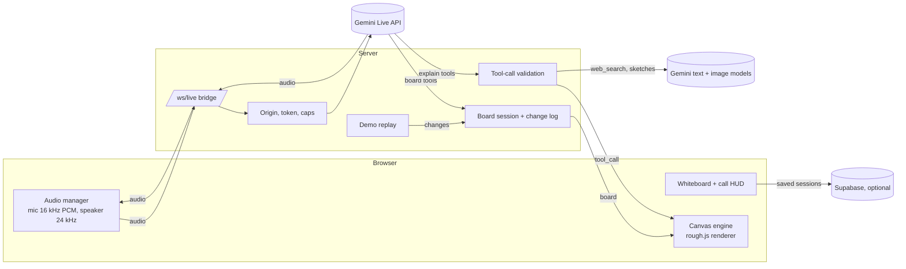

# Architecture

## Components

## The tool loop

1. On **Start call** the browser opens `/ws/live`. The upgrade is refused unless the origin is allowlisted, the access token matches (when one is configured) and the server is below its connection cap.
2. The server opens a Live API session with the coach prompt (`server/prompts/coach.ts`, versioned) and its tools, and relays microphone audio in and speech out.
3. The coach's main tools edit the board model (`server/board-tools.ts`): `set_title`, `add_component`, `remove_component`, `set_team`, `remove_team`, `connect`, `disconnect`. Each call becomes a change for the session's board (`shared/board/changes.ts`) with actor `coach` and the reason the model gives, and is logged on the server. Only the user can clear the board: the toolbar sends a change with actor `user`.
4. An accepted change updates the board, which is sent to the browser (`board` message). The tool result returns a compact summary of the whole board, so the model always works from the real state. A refused change returns the reason and the board.
5. The browser keeps the latest board and hands it back when a new call starts, so ending a call, a reconnect or a session limit never wipes the design.
6. The browser lays the board out (`shared/board/layout.ts`), turns the layout into canvas elements with stable ids (`src/lib/canvas/boardElements.ts`) and syncs them (`syncBoardElements`): new elements animate in, changed ones update in place, and the view zooms out only when the board no longer fits.
7. A few tools inform or explain rather than build: `search_microsoft_docs` (the official Microsoft Learn MCP server's documentation search, `server/microsoft-docs.ts`; the prompt requires it before any Microsoft-specific advice), `web_search` (grounded search for everything else), `draw_callout` (a note attached to a card by name), `highlight_area` and `generate_sketch_illustration` (image model, then SVG synthesis, then a procedural fallback). Their arguments are validated (`server/validation.ts`) before they reach the browser.
8. On Live models with asynchronous function calling, every tool is declared non-blocking (`server/live-tools.ts`): board and drawing results return SILENT, so the coach keeps narrating; search and sketch results return WHEN_IDLE. Nothing about the board is ever sent to the model as a new message, which would start a new turn.
9. The session ends on **End call**, at the session limit or after the idle timeout.

## Layout model

The layout is computed from the board, never chosen by the model. Left to right: triggers, then a guardrails lane above one container per team, then outputs. Inside a team, agents are placed by orchestration pattern:

| Pattern | Placement |
|---|---|
| Sequential | a row, in execution order, each passing to the next |
| Concurrent | a column, fanned out from the team input and back in |
| Handoff | the start agent on the left, the agents it hands off to on the right |
| Group chat, Magentic | the manager on top, participants in a row below |

The tools, knowledge and approvals a team uses sit in a lane below its agents, each approval next to what it gates. Connections are routed orthogonally through the gaps between columns. Tests check that no two cards overlap and that no connector crosses a card it does not connect.

## Demo mode

Without `GEMINI_API_KEY`, starting a call replays `server/demo.ts`: a goal, narration and the board changes for a customer support system. The replay goes through the same board session and change log as a live session, so it exercises the real path. The tests check that every change is accepted, that the design contains a guardrail and an approval, and that the board lays out cleanly.

## Persistence

Sessions (goal, transcript, canvas elements) are saved to a Supabase `call_sessions` table when `VITE_SUPABASE_URL` and `VITE_SUPABASE_ANON_KEY` are set, and to browser storage otherwise. The roadmap moves the board itself into a versioned tree; see [ROADMAP.md](ROADMAP.md).

## Security model

See the table in the [README](../README.md#security). The main design choice is that the browser never talks to the model provider: the server is the only party holding credentials, and it treats both the model's tool calls and search results as untrusted input.
