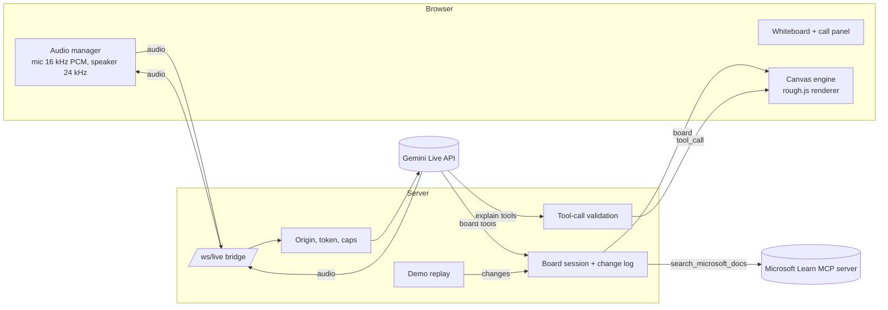
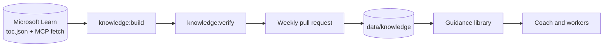

# Architecture

## Components

## The tool loop

1. On **Start call** the browser opens `/ws/live`. The upgrade is refused unless the origin is allowlisted, the access token matches (when one is configured) and the server is below its connection cap.
2. The server opens a Live API session with the coach prompt (`server/prompts/coach.ts`, versioned) and its tools, and relays microphone audio in and speech out.
3. Nothing is built before the brief has a goal: the user can write it in the app before the call (sent with `start_call` and saved as the user's change), or the coach asks for it and saves it with `set_brief`. The session opens with one instruction built from the brief (`openingPrompt`). The change log refuses every building change until a goal exists.
4. The coach's main tools edit the board model (`server/board-tools.ts`): `set_brief` and `record_item` for the stage documents, `set_scenario` for runtime scenarios, `review` for the Well-Architected review, and `set_title`, `add_component`, `remove_component`, `set_team`, `remove_team`, `connect`, `disconnect` for the design. Each stage accepts only its own changes, and only the user approves a stage (`shared/board/stages.ts`). Each call becomes a change for the session's board (`shared/board/changes.ts`) with actor `coach` and the reason the model gives, and is logged on the server. Only the user can clear the board: the toolbar sends a change with actor `user`.
5. An accepted change updates the board, which is sent to the browser (`board` message). The tool result returns a compact summary of the whole board, so the model always works from the real state. A refused change returns the reason and the board.
6. The browser keeps the latest board and hands it back when a new call starts, so ending a call, a reconnect or a session limit never wipes the design.
7. The browser lays the board out (`shared/board/layout.ts`), turns the layout into canvas elements with stable ids (`src/lib/canvas/boardElements.ts`) and syncs them (`syncBoardElements`): new elements animate in, changed ones update in place, and the view zooms out only when the board no longer fits.
8. Three tools inform or explain rather than build: `search_microsoft_docs` (the official Microsoft Learn MCP server's documentation search, `server/microsoft-docs.ts`; the prompt requires it before any Microsoft-specific advice), and `draw_callout` and `highlight_area` (a note or highlight on the board). The coach has no web search, image generation or free drawing. Drawing arguments are validated (`server/validation.ts`) before they reach the browser.
9. On Live models with asynchronous function calling, every tool is declared non-blocking (`server/live-tools.ts`): board and drawing results return SILENT, so the coach keeps narrating; documentation results return WHEN_IDLE. Nothing about the board is ever sent to the model as a new message, which would start a new turn.
10. The session ends on **End call**, at the session limit or after the idle timeout.

## Layout model

The board is drawn as a workspace of stage frames (`shared/board/workspace.ts`): discovery's context diagram on top, the solution design below it, and later stages below that. The app pans to the frame of the current stage, so approving a stage moves the view to where the next one is drawn.

The layout is computed from the board, never chosen by the model, and follows the notation in [DESIGN_STANDARD.md](DESIGN_STANDARD.md#notation). Left to right: triggers, then the system boundary, then outputs. Inside the boundary, each guardrail is a band across the system, above one container per team. Inside a team, agents are placed by orchestration pattern:

| Pattern | Placement |
|---|---|
| Sequential | a row, in execution order, each passing to the next |
| Concurrent | a column, fanned out from the team input and back in |
| Handoff | the start agent on the left, the agents it hands off to on the right |
| Group chat, Magentic | the manager on top, participants in a row below |

The tools, knowledge and approvals a team uses sit in a lane below its agents. An approval sits on the path to the tool it gates: the agent's line reaches the approval, and the approval leads to the tool. Connections are routed orthogonally through the gaps between columns. A legend under the drawing names the line and border styles in use. Tests check that no two cards overlap, that no connector crosses a card it does not connect, that teams and bands sit inside the boundary with triggers and outputs outside it, and that the legend lists only the styles in use.

The call panel shows how far the board is through the design standard (`readiness()`), with the next step named and every open item explained.

## Guidance snapshot

Microsoft's architecture guidance ships with the repository in `data/knowledge/`: the Well-Architected Framework, the AI section of the Azure Architecture Center and the AI agents section of the Cloud Adoption Framework, one JSON file per source. Each page keeps its place in Microsoft's table of contents, its area and pillar, and its sections; each section keeps its heading trail, a link to that heading on Microsoft Learn, and its text. The design review checklist items (RE:01, SE:06, ...) are listed separately.

Agents read it by progressive disclosure, never as a whole: the outline of a source, area or pillar, then a page's headings, then one section, with a keyword search for terms whose place is unknown. A quote is accepted only if it appears in the section it cites. The snapshot needs no database or network at runtime; the decision and its alternatives are in [ADR 0006](adr/0006-guidance-snapshot.md).

## Demo mode

Without `GEMINI_API_KEY`, starting a call replays `server/demo.ts`: a goal, narration and the board changes for a customer support system. The replay goes through the same board session and change log as a live session, so it exercises the real path. The tests check that every change is accepted, that the design contains a guardrail and an approval, and that the board lays out cleanly.

## Compile

Once technical design is approved, the browser sends its board to `POST /api/compile`. The server validates it, compiles it (`server/compile/`: the AI Landing Zone from `vendor/`, `azure.yaml`, the agents' code, evaluations and documents) and runs the rules (`server/compile/checks.ts`) with the user's settings. The compile studio shows the project as a folder coloured by origin, the rubric, and the questions. `POST /api/export` repeats both and returns the zip only when no blocking rule fails and a person approves. Compile and export need no call and no model; they are deterministic. The decisions are in [ADR 0003](adr/0003-compile-to-foundry-package.md).

## Persistence

Sessions (goal, transcript, canvas elements) are saved in browser storage. The roadmap moves the board into a versioned tree per project; see [ROADMAP.md](ROADMAP.md).

## Security model

See the table in the [README](../README.md#security). The main design choice is that the browser never talks to the model provider: the server is the only party holding credentials, and it treats the model's tool calls, the user's input and documentation results as untrusted.

## Guard pipeline

Rules in the prompt are a request; the guard (`server/guard/`) enforces them in code on every hop.

| Hop | Check | On failure |
|---|---|---|
| Input: the brief | Prompt Shields user prompt analysis | Not saved; the user is told why |
| Input: typed message | Prompt Shields, before the model sees it | Not sent to the model |
| Input: speech | Live API input transcription, each finished turn screened | Notice to the model and the user; screened after the model heard it |
| Input: pasted document | Prompt Shields document analysis, before the model sees it; kept with an id for provenance | Not added; the user is told why |
| Pre-tool: document item or building change | Provenance: `basis_source` and `basis_quote` must be found in the brief, the user's transcribed words or the named pasted document; then the typed change log, which also refuses design before discovery is done | Refused with a reason the coach can act on |
| Pre-tool: drawing call | Tool allowlist and argument validation | Refused |
| Post-tool: documentation | Only Microsoft Learn links kept; Prompt Shields document analysis | Withheld, also when it cannot be screened |
| Output: speech | Output transcription checked for reciting the instructions | Notice to the model |
| All | Audit trail, one JSON line per decision | |

Provenance is the core control against invention. A pasted document's words count only as the document's: a quote from it must name the document, and it never counts as something the user said in the call. The quote check tolerates transcription noise (three quarters of the quote's words must appear, and at least one pair of adjacent words) but not invented content or shuffled words. It does not judge scope: if the user asks for something off-topic in their own words, the prompt's scope rule is what declines it.

Prompt Shields is probabilistic, so it is one layer, not the boundary. When it is not configured or not reachable, user input is marked unscreened in the audit trail (fail open, so a call is not cut by an outage) and documentation results are withheld (fail closed, because the coach can work without them). The demo replays recorded changes and does not pass through the guard.
