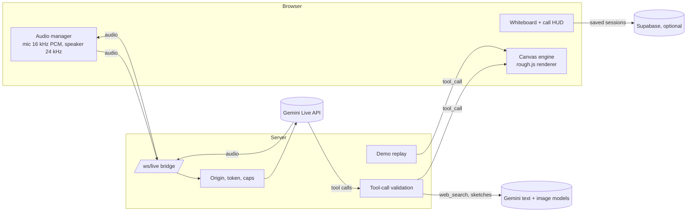

# Architecture

## Components

## The tool loop

1. On **Start call** the browser opens `/ws/live`. The upgrade is refused unless the origin is allowlisted, the access token matches (when one is configured) and the server is below its connection cap.
2. The server opens a Live API session with the system instruction and 14 function declarations, and relays microphone audio in and speech out.
3. When the model calls a tool, the server validates it (`server/validation.ts`). Unknown tools get an error response so the model can correct itself; valid calls are forwarded as `tool_call` messages with clean arguments.
4. Two tools run on the server: `web_search` (grounded search, returned to the model wrapped as untrusted data) and `generate_sketch_illustration` (image model first, then SVG synthesis, then a procedural fallback, so the board always gets a picture).
5. The canvas engine animates the drawing and reports the board back (`canvas_state_update`). The server stores it per session (`server/board-tracker.ts`) and returns the list of components inside tool results. It is never sent to the model as a message: that would start a new turn, and the model would answer it by drawing again.
6. On Live models with asynchronous function calling, every tool is declared non-blocking (`server/live-tools.ts`). Drawing results are returned with SILENT scheduling, so the model keeps narrating; search and sketch results with WHEN_IDLE, so they are used once the current sentence ends. A component or connection already on the board is not drawn again; the model is told it exists.
7. The session ends on **End call**, at the session limit or after the idle timeout.

## Layout model

Components are placed on a four-column grid that encodes the architecture itself:

| Column | Holds |
|---|---|
| 1 | Intake and triggers |
| 2 | Router, supervisor or orchestrator |
| 3 | Specialist agents and tools |
| 4 | Guardrails, memory and human approval |

The model can pass a grid slot, explicit coordinates or neither; the engine resolves position by role and avoids collisions. Connections are drawn between component borders using their labels.

## Demo mode

Without `GEMINI_API_KEY`, starting a call replays `server/demo.ts`: a goal, narration and drawing steps for a customer support system. The replay uses the same message types and the same validator as a live session, so it exercises the real path. The tests check that every step validates, that every connection targets a component already drawn, and that the design contains a guardrail and a human approval gate.

## Persistence

Sessions (goal, transcript, board elements) are saved to a Supabase `call_sessions` table when `VITE_SUPABASE_URL` and `VITE_SUPABASE_ANON_KEY` are set, and to browser storage otherwise. The roadmap moves the board itself into a versioned tree; see [ROADMAP.md](ROADMAP.md).

## Security model

See the table in the [README](../README.md#security). The main design choice is that the browser never talks to the model provider: the server is the only party holding credentials, and it treats both the model's tool calls and search results as untrusted input.
